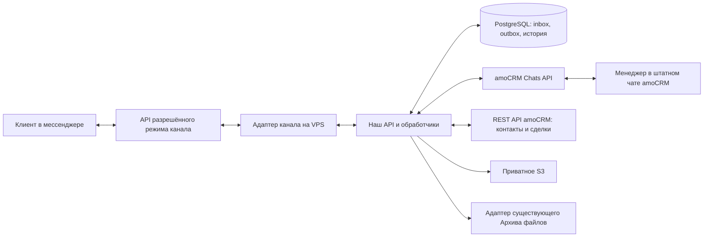

# Размещение сервиса и связь с amoCRM

Статус на 22.10.2026: целевая схема для внутреннего сервиса компании; production-контур развёрнут и отвечает по HTTPS (`https://messengers.example.com`, `/health/live` и `/health/ready`). Интеграция amoCRM (REST/OAuth, Chats webhook по сырым байтам, workflow) реализована, live-проверка на рабочем аккаунте не выполнялась. Подключение существующего архива файлов не реализовано: передача отключена до получения контракта плагина.

## Где работает продукт

Уточнение размещения от 21.10.2026: для первого пилота выбран существующий VPS, отдельный каталог `/opt/messengers2amo` и Docker Compose-проект `messengers2amo` за существующим nginx. Это заменяет предположение об отдельном VPS. HTTP API, фоновые обработчики и собственная PostgreSQL 18 развёрнуты в этом Compose-проекте; лимиты контейнеров заданы, суммарный бюджет ресурсов проверен при выкладке. При нехватке ресурсов другое размещение согласуется до запуска. PostgreSQL и служебные порты доступны только внутреннему контуру; наружу предоставляется HTTPS.

Файлы хранятся в приватном S3, резервные копии БД — за пределами VPS. Административный интерфейс управляет подключениями, мастерскими, маршрутами, правами и диагностикой. Основная переписка менеджера остаётся в штатных чатах amoCRM. Чужие проекты, включая OpenClaw и MCP, не используются как контейнеры, сети или хранилища сервиса. Целевой домен — `messengers.example.com`; loopback upstream — `127.0.0.1:18767`. Ошибка `ERR_CERT_COMMON_NAME_INVALID` от 21.10.2026 была вызвана отсутствием vhost (см. [инвентаризацию](vps-inventory-2026-10-21.ru.md)) и на 22.10.2026 устранена: HTTPS отвечает. [Инструкция размещения](../../ops/deploy/messengers2amo/INSTRUCTION.ru.md) содержит условия выпуска, nginx-шаблон и приёмку; повторный Caddy на 80/443 не требуется.

Стрелка к каналу означает требуемый интерфейс, а не уже доказанный доступ к любому рабочему аккаунту. Обычный MAX, официальный WhatsApp, фактический Telegram-режим и VK проходят отдельные проверки.

## Два механизма подключения amoCRM

1. REST/OAuth: разрешённая интеграция получает доступ к данным CRM. Backend хранит секреты и управляет ротацией/отзывом; менеджер не вводит ключи при каждой переписке.
2. Chats: отдельная регистрация канала, привязка account/amojo/scope и webhook HTTPS. Для Chats используется собственный канальный секрет и подписи; это отдельный протокол от Bearer OAuth.

Для технических источников отдельно проверяется готовность виджета/Sources API. Технический источник переписки не перезаписывает рекламное происхождение клиента. Регистрация, получение разрешений и принятие условий — отдельные внешние шаги; документ не подтверждает, что они выполнены. [Проверка официальных API](../requirements/api-verification-2026-10-21.ru.md).

## Входящее сообщение

Адаптер получает событие, проверяет его происхождение и сохраняет durable inbox с ключом дедупликации. Обработчик определяет подключение и его эпоху, вид чата, мастерскую и маршрут CRM. Внутренние группы и неизвестные типы по умолчанию не создают CRM-эффектов. Разрешения определяются по неизменяемому ID, а не названию группы.

Для разрешённого события находим доказанную связь с контактом/диалогом; при нескольких подходящих заказах не выбираем случайную сделку. Только один согласованный механизм создаёт заявку. В outbox фиксируется намерение CRM-проекции, затем выполняется Chats/REST запрос. Результат и внешние идентификаторы сохраняются; неизвестный исход требует сверки, а не слепого повторного создания.

## Ответ менеджера

Менеджер отвечает в штатном чате amoCRM. Наш endpoint проверяет raw подпись и соответствие scope/account, сохраняет событие до подтверждения приёма и передаёт его фоновой обработке. Затем проверяются автор, право отправки через конкретное подключение, мастерская, адресат и актуальность подключения. Получение необходимых данных об авторе и правах должно быть подтверждено настоящим PoC. Неизвестный автор не считается пройденным персональным ACL.

После допуска создаётся устойчивая команда отправки. Адаптер отправляет её от выбранной рабочей идентичности и фиксирует sent/failed/unknown. Только реальные наблюдения позволяют передать delivered/read в amoCRM. Результат HTTP-запроса сам по себе не доказывает доставку. Учёт внимания/snapshot и правила повторов реализованы в `apps/api` (`domain/attention.ts`, `repo/attention.ts`).

Права backend не скрывают сообщения, уже опубликованные в CRM: видимость штатного чата обеспечивают права самой amoCRM. Это часть приёмки маршрутов и доступа по мастерским.

## Файлы и существующий архив

Наш сервис проверяет вложение и сохраняет приватный объект S3 с размером, MIME, SHA-256 и исходными идентификаторами. Отдельное намерение передаёт индекс существующему Архиву файлов через согласованный интерфейс. Успех S3 не означает подтверждение индекса архива. До получения контракта плагина передача отключена; прямой записи в его БД нет.

Удаление или слияние CRM-сущности сохраняет исходные связи и историю. Оно не является командой удалить оригинал в мессенджере, S3 или архиве. Автоматическая очистка в первом выпуске отключена.

## Как включаем пилот

Сначала проверяем ядро на синтетических данных, затем развёртываем тестовый контур с HTTPS и резервным восстановлением. После согласованной установки интеграции доказываем входящее/ответ/медиа/права на тестовых активах. Переносим одно подключение с единственным владельцем отправки и проверенным возвратом. Действующий Wazzup сохраняется до фактической приёмки пилота.

Связанные задачи: #3, #4, #6, #8–#13, #17–#21, #26. [Уточнения требований](../requirements/amocrm-spec-delta.ru.md).
