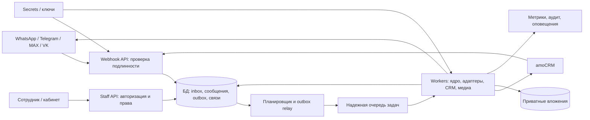
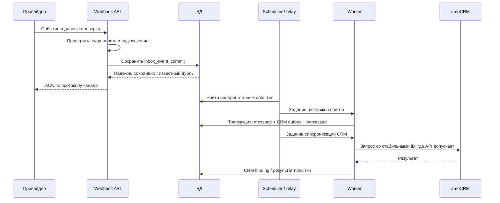
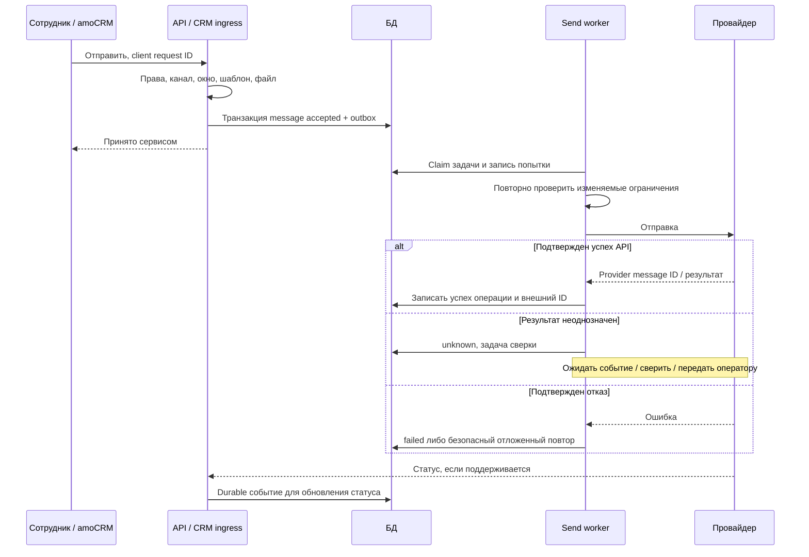

# Примерная архитектура внутреннего сервиса мессенджеров

Выбор технологического baseline и порядок запуска рядом с действующим Wazzup уточнены в [плане стека и параллельного запуска](stack-and-parallel-rollout.ru.md) от 21.10.2026. Он конкретизирует приведенные ниже варианты для пилота. Инфраструктура обследована ([инвентаризация VPS](architecture/vps-inventory-2026-10-21.ru.md)), production-контур развёрнут; боевые подключения каналов и рабочий amoCRM ещё не проверялись.

Дополнение от 21.10.2026: [подробная доменная логика](messenger-domain-logic.ru.md), [сценарии приемки](messenger-logic-acceptance.ru.md). Диаграммы ниже показывают общий поток; условия переходов, покрытие входящих ответом и конкурентное назначение раскрыты в спецификации. Это проектные решения, не новые результаты проверки API.

Дата: 20.10.2026; статус уточнён 22.10.2026. Статус: архитектурная основа; ядро (приём событий Telegram, назначения, внимание и снимки ответа, медиа, amoCRM, мастерские) реализовано в `apps/api` и покрыто тестами; адаптеры WhatsApp Cloud, MAX и VK реализованы за общим интерфейсом, их webhook-маршруты в API не зарегистрированы. Production развёрнут. Нагрузочные измерения не проводились; live-проверка внешних каналов и рабочего amoCRM не выполнялась. Сценарий подтвержден заказчиком: одна компания, несколько отделов, сотрудников и своих бизнес-аккаунтов; amoCRM. Публичный SaaS, клиентский биллинг и массовый onboarding сторонних компаний исключены.

Связанные материалы: [требования](messenger-platform-requirements.ru.md). Поддержку конкретных API и аккаунтов проверяем по источникам требований и на пилоте. Ни одна диаграмма ниже не является схемой внутреннего устройства Wazzup.

## 1. Выбор подхода

| Подход | Что получаем | Цена решения |
|---|---|---|
| Внешний агрегатор + свой интерфейс/CRM-слой | Быстрый пилот, меньше разработки адаптеров | Платежи и зависимость от поставщика; проверить экспорт, доступы и фактические каналы |
| Собственные адаптеры, модульный монолит + workers | Контроль данных, единая модель, независимые фоновые процессы | Нужно поддерживать API каналов и эксплуатацию |
| Независимые микросервисы каналов | Отдельные релизы и масштабирование команд | Сложнее трассировка, контракты и согласованность данных |

Рекомендация для собственного продукта — второй вариант. Одна кодовая база с модулями; HTTP API и workers запускаются разными процессами. Это не требует микросервисов или Kubernetes. Решение об отказе от агрегатора принимаем после проверки доступов и расчета совокупных расходов.

Для первой вертикали достаточно стандартного чата amoCRM и кабинета подключений. Полноценный независимый inbox добавляется, если нужны отдельный список ожидания ответа и работа вне CRM.

## 2. Компоненты

БД — основной источник состояния. Брокер ускоряет обработку; потерянное уведомление восстанавливается сканированием необработанного inbox/outbox. В простой версии допустима очередь заданий в самой БД с блокировками и lease, без отдельного брокера.

Кандидаты: PostgreSQL; RabbitMQ при необходимости отдельного брокера; S3-совместимое хранилище медиа. Redis опционален для кэша и ограничителей, не для единственного хранения сообщений. Backend и frontend выбираем по компетенциям команды; framework не влияет на обязательные гарантии обработки.

| Модуль | Ответственность / контракт |
|---|---|
| Connections | Состояние аккаунта, ссылка на секрет, разрешения, доступные операции |
| Webhook ingress | Проверка запроса конкретного провайдера, durable inbox, быстрый корректный ACK |
| Channel adapters | Нормализация событий, проверка возможностей, отправка и классификация результата |
| Conversation core | Сообщения, назначения, ожидание ответа, статусы и версии |
| CRM bridge | Связи контактов/сделок/чатов, синхронизация и устранение эха |
| Media | Загрузка, проверки, приватное хранение и контролируемая выдача |
| Staff / access | Сотрудники, отделы, роли, аудит |
| Jobs / operations | Повторы, сверка неопределенных результатов, очередь ошибок и диагностика |

Предлагаемые внутренние endpoints: `POST /connections`, `GET /connections/{id}/health`, `GET /conversations`, `POST /conversations/{id}/messages`, `POST /conversations/{id}/assign`, `GET /messages/{id}`. Названия проектные, не endpoints внешних API. Идентификатор сотрудника определяется сервером из сессии, не доверяется полю запроса.

Команда отправки получает ключ идемпотентности и возвращает ID сообщения с `accepted` после commit. Повтор того же ключа и содержимого возвращает существующий результат; иное содержимое с тем же ключом — конфликт.

## 3. Входящее сообщение

При недоступной БД webhook не получает успешное подтверждение сохранения; дальнейший повтор зависит от провайдера. После длительного простоя возможны внешние потери событий — это ограничение проверяем на каждом канале.

Дедупликация использует идентификатор события, если он есть. Новое сообщение, редактирование, удаление и изменение статуса — разные события. При отсутствии event ID адаптер определяет устойчивый ключ по документированным полям; хеш текста не годится: одинаковые сообщения могут быть легитимными. Неподдерживаемые случаи фиксируются как ограничения.

Изменение сообщения и задание outbox записываются в одной транзакции. Relay и consumers допускают повтор. Это применение [transactional outbox](https://docs.aws.amazon.com/prescriptive-guidance/latest/cloud-design-patterns/transactional-outbox.html); использовать AWS для него не обязательно.

CRM bridge хранит соответствия, подавляет эхо своих исходящих и сериализует создание привязки. Не предполагаем наличие универсального HTTP-заголовка идемпотентности у amoCRM: используем предусмотренные API внешние ID и локальные связи. При неопределенном создании контакта/сделки — сверка либо разбор, а не слепое создание заново.

## 4. Исходящее сообщение и неопределенность

`accepted` означает прием нашим сервисом; `sent` — подтвержденный успех отправки согласно семантике адаптера; `delivered/read` — только реальные подтверждения провайдера. `failed` — подтвержденный отказ, `unknown` — неизвестный результат. Успех HTTP не доказывает прочтение.

После таймаута или падения worker между отправкой и записью результата повтор может создать дубль. Автоматический повтор допустим при документированной идемпотентности или доказанном отсутствии принятой отправки. Иначе — сверка доступным методом, ожидание webhook либо ручное решение с предупреждением. Сменить фактический статус вручную на «доставлено» нельзя.

Порядок команд обеспечивается внутри диалога и подключения; часы и UUID не являются гарантией порядка. Статусы могут прийти раньше ответа API: сохраняем их и связываем позже. Не понижаем `read` до `sent` из-за запоздалого события.

## 5. Данные

Во всех сущностях проверяем принадлежность компании и подключению, включая внешние ключи; одной фильтрации UI недостаточно. Для текущей установки компания одна.

| Сущность | Основные поля / ограничения |
|---|---|
| company, department, staff, membership | Организация, отделы, сотрудники, роли и доступные подключения |
| channel_connection | Компания, тип, внешний аккаунт, secret reference, состояние, capabilities |
| channel_identity | Подключение + внешний пользователь; уникальность в области адаптера |
| conversation | Подключение + внешний чат; ответственный, отдел, waiting_since |
| work_item, assignment_history | Цикл обработки обращения, локальный исполнитель, assignment_version и причины передачи; не равны ответственному контакта/сделки CRM |
| attention_obligation, reply_coverage | Требование ответа на входящее/существенную правку и подтвержденная связь с конкретным ответом |
| reply_snapshot, routing_decision | Снимок доступных обязательств ответа; версия правил, причины и результат назначения |
| message | Диалог, направление, внешний ID, client request ID, версия, статус |
| inbox_event | Подключение, ключ события/мутации, payload, время, состояние обработки |
| outbox_job | Тип, aggregate ID, версия, ключ операции, lease, next_attempt_at |
| delivery_attempt | Job + номер попытки, внешний ID, исход, классифицированная ошибка |
| attachment | Компания, message ID, storage key, размер, MIME, хеш, статус проверки |
| crm_connection, crm_binding | CRM аккаунт/scope, локальная сущность, внешний ID, состояние синхронизации |
| consent, audit_event | Основание/цель согласия и отзыв; кто и что изменил |

Для сообщений уникальность provider ID определяется областью конкретного API: чат или подключение. Все локальные command keys ограничены компанией и соответствующей операцией. Нельзя предполагать, что ID сообщения глобально уникален между ботами.

Один CRM-контакт может иметь несколько каналов и сделок: не ставим уникальность «контакт → один диалог». Согласие хранит канал, цель, источник, дату и отзыв, а не один общий boolean. Сырой inbox содержит персональные данные: ограничиваем доступ и retention, не дублируем его в обычных логах.

## 6. Безопасность и медиа

Роли: администратор подключений; руководитель; оператор своих/назначенных диалогов; поддержка с ограниченным доступом; технический worker. Проверки выполняются сервером при чтении, отправке, экспорте и скачивании. При передаче диалога права пересчитываются.

Webhook-проверка отдельная для каждого провайдера; детали берем из его актуальной документации. Route/connection ID не является секретом. Неверный запрос не обрабатывается. Telegram и MAX секреты webhook не подменяют токены исходящего API.

OAuth обновляется одним исполнителем на подключение с повторной проверкой версии и атомарной записью новой пары. Учитываем неопределенный результат refresh; старый refresh token нельзя бесконечно повторять. Секреты — в защищенном хранилище; ключи резервируем отдельно, в логи не пишем.

Медиа скачивает изолированный worker: allowlist/правила источников, запрет внутренних и link-local адресов, повторная проверка DNS и каждого redirect, лимиты размера/времени, проверка MIME и антивирус/карантин. Объекты приватные. CRM получает ограниченную по области и сроку ссылку либо согласованный download gateway; ее доступность и обновление при повторной загрузке проверяем прототипом. Постоянные открытые bucket исключены.

RLS в PostgreSQL — опциональная дополнительная защита, не замена RBAC. [Документация PostgreSQL](https://www.postgresql.org/docs/current/ddl-rowsecurity.html) указывает обход политик владельцем и привилегированными ролями; рабочая роль и контекст пула соединений должны учитывать это.

## 7. Развертывание и ориентиры мощности

Пилот: контейнеры API и workers, БД, приватное хранилище и резервные копии в отдельной зоне отказа; TLS, мониторинг, миграции и проверенный откат. Одна VM допустима как осознанный пилот с единой точкой отказа. Резервирование API, БД и брокера добавляется по согласованным целям доступности; «две VM» само по себе не гарантирует HA.

Пример расчета, не данные компании: 10 000 сообщений/день, 20% с медиа по 1 MB = около 2 GB/день, 60 GB за 30 дней без реплик, версий и backup. Для метаданных при условных 3 KB/сообщение — 30 MB/день до дополнительного inbox, аудита и индексов. CPU/RAM определяем нагрузочным тестом, не этой формулой.

Цели для обсуждения: p95 сохранения webhook до 500 ms; p95 от приема до видимости в CRM до 5 s при здоровых внешних API; RPO до 15 минут и RTO до 4 часов для пилота. Это предложения, не результаты и не сроки внешнего API. Метод измерения, исключения и стоимость более строгих целей согласуем отдельно.

Метрики: возраст inbox/outbox, unknown/failed, задержка CRM, состояние каналов, token refresh, ошибки медиа, диск, backup. Оповещение по доступному дежурному каналу должно работать при отказе самого сервиса.

## 8. Этапы и приемка

1. Получить реальные свои аккаунты, правила доступа и хранения; проверить двусторонний текст/медиа и отзыв доступа каждого обязательного канала.
2. Одна вертикаль «канал → amoCRM → ответ», durable inbox/outbox и диагностируемая отправка.
3. Остальные подтвержденные адаптеры, назначения и ограниченный пилот отдела.
4. Нагрузочная проверка, восстановление backup, документация эксплуатации; затем отдельный inbox при необходимости.

Проверки в тестовом окружении:

| Сбой | Ожидаемый результат |
|---|---|
| Повтор webhook и запоздалый статус | Одно сообщение, сохраненная мутация, корректный итоговый статус |
| Падение после commit до очереди | Задание найдено сканером |
| Отключение брокера | Накопление в БД в пределах мощности, восстановление без логической потери |
| Таймаут после принятой отправки | unknown, без слепого повтора |
| Неопределенное создание CRM-сущности | Сверка/разбор, защита от повторного создания |
| Гонка OAuth refresh | Один refresh, согласованная пара токенов |
| Чужой диалог, файл, внутренний URL | Доступ отклонен, SSRF-запрос не выполняется |
| Восстановление backup | Проверены данные, ключи, очередь, актуальность согласий и безопасный запуск workers |

После восстановления нельзя автоматически отправлять весь старый outbox: сначала сверяем отправки, отзывы согласий и состояние внешних аккаунтов.

## 9. Решения, которые еще нужны

Сколько операторов, отделов и подключений; какие каналы обязательны; нужен ли отдельный inbox; допустима ли остановка при отказе одной VM; сроки хранения; правила объединения клиентов; доступ к личным аккаунтам; источник истины для ответственного и контактных данных. До ответа сохраняем ограниченный MVP и не включаем рассылки, ИИ, нативные приложения и пользовательские клиенты.

Основа документа: отобранные предложения Antigravity Gemini 3.8 Flash High и проверка Codex. Неподтвержденные квоты, предположения о новых API и обещания правового соответствия исключены.
