# Презентация Messengers2amo

Материалы инженерного и продуктового кейса на 29 октября 2026 года.

- [PDF для просмотра](messengers2amo-project-case.pdf) — 13 слайдов.
- [Редактируемый PowerPoint](messengers2amo-project-case.pptx) — текст, схемы и таблицы остаются редактируемыми, пример переписки представлен изображением.
- [Текст кейса](case-study.md) — проблема, личный вклад, стек, результаты и ограничения.
- [Заметки для выступления](speaker-notes.md) — сценарий по слайдам и источники.
- [Проверки публикации](verification.md) — результаты проверки кода и файлов презентации.
- [Веб-версия](index.html) — скачайте каталог и откройте файл в браузере. Клавиши влево/вправо переключают слайды, F включает полный экран. GitHub показывает HTML как исходный код; публикация GitHub Pages не включалась.
- [Изображения слайдов](slides/) — PNG для предпросмотра и вставки в другие материалы.

PDF содержит изображения слайдов, чтобы сохранять одинаковый вид на разных устройствах. Текстовая версия доступна в кейсе и заметках. Для редактирования используйте PowerPoint.

## Предпросмотр

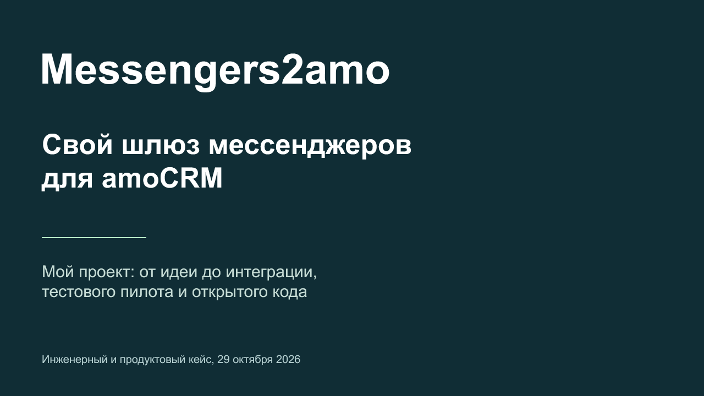

Все слайды

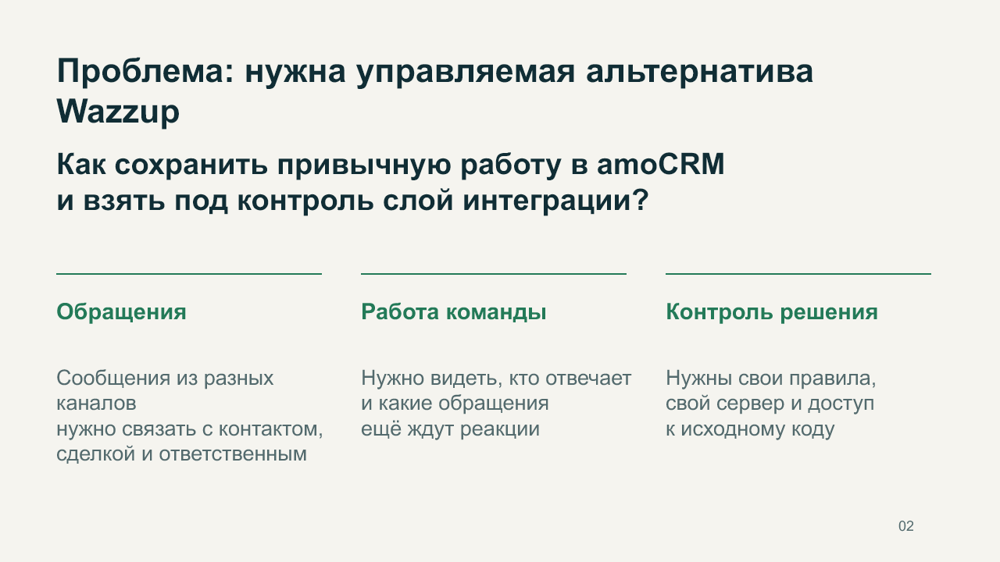
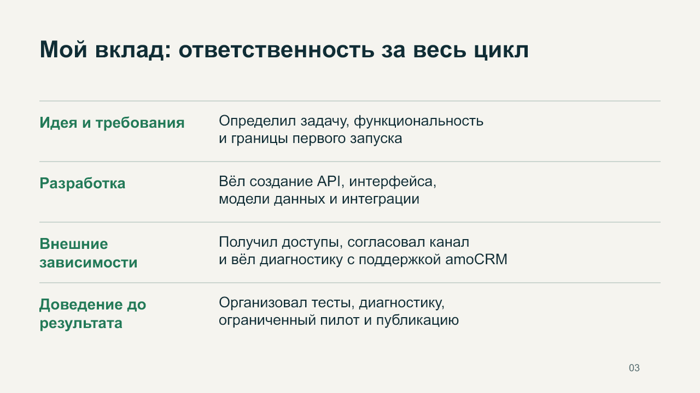
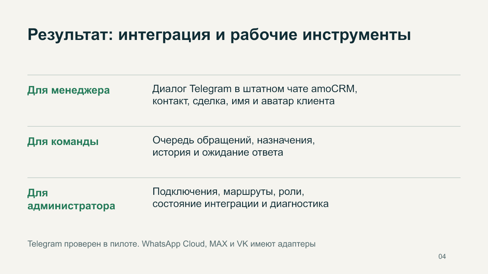
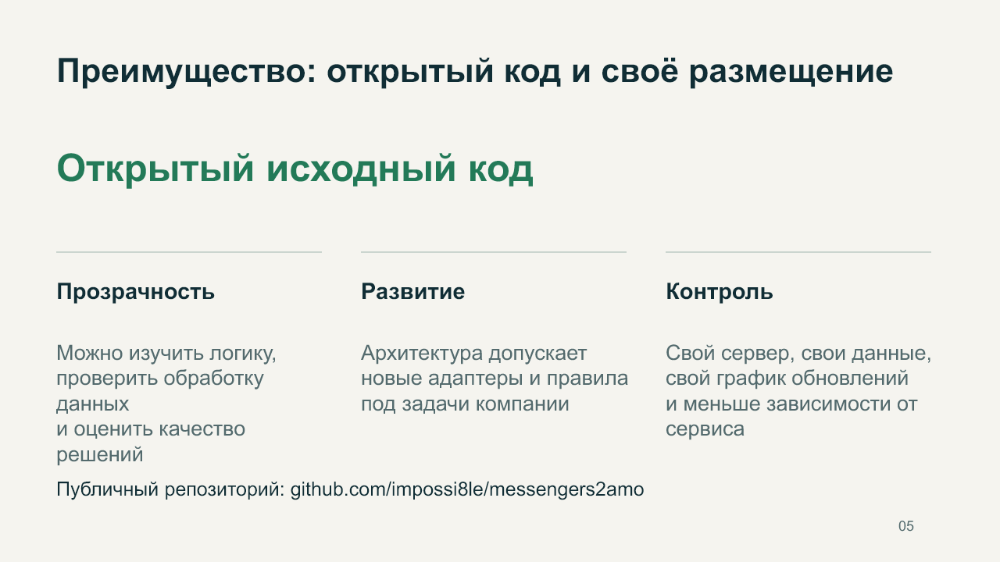
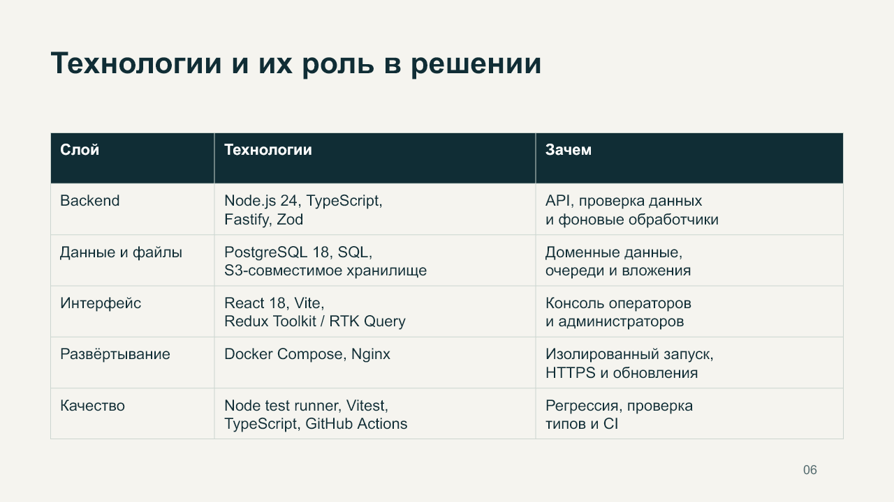
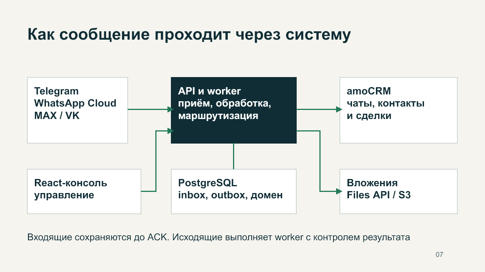
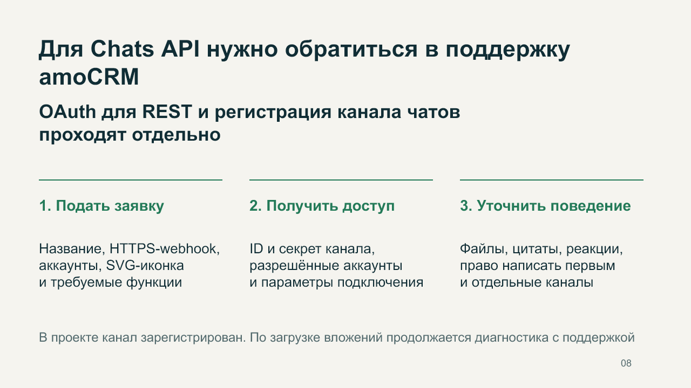
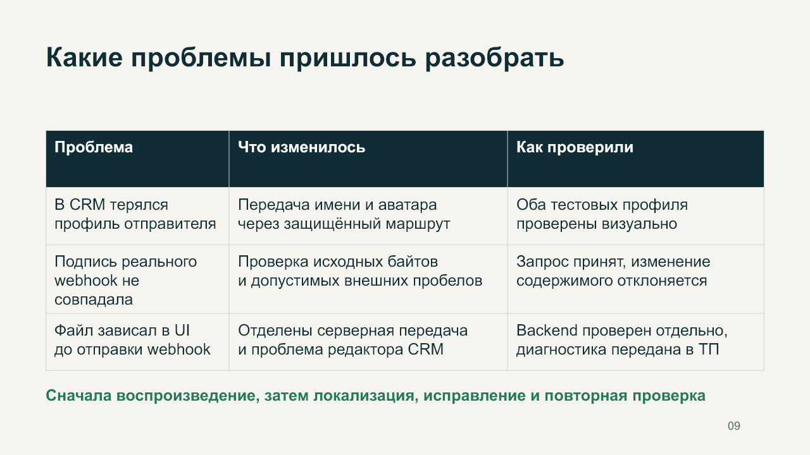
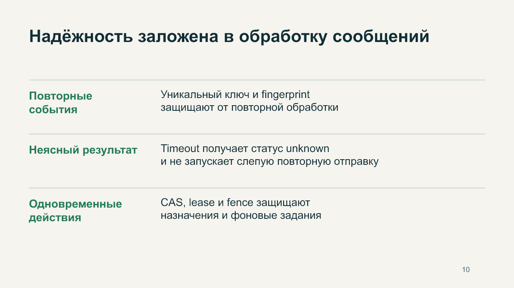
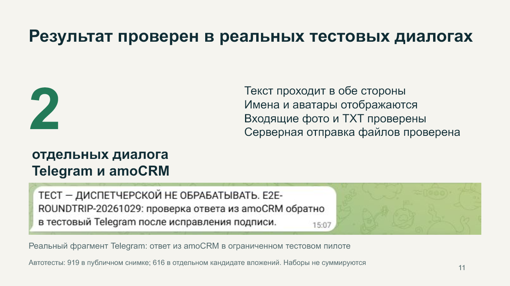
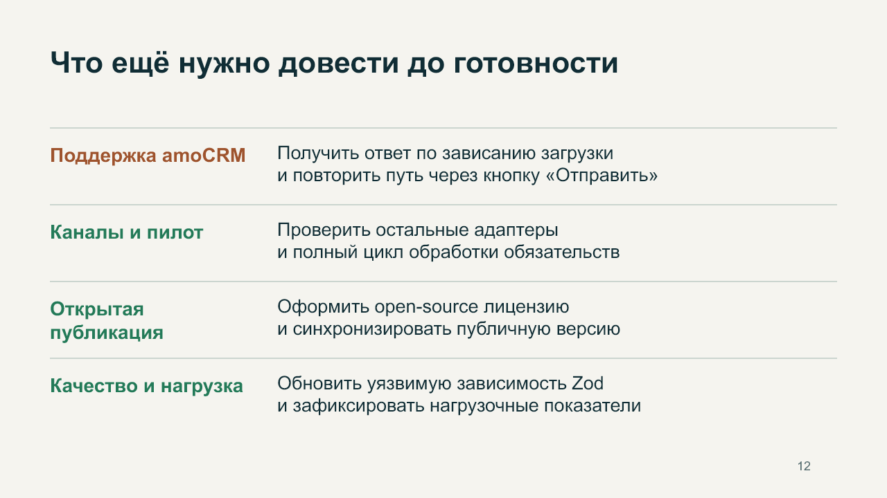
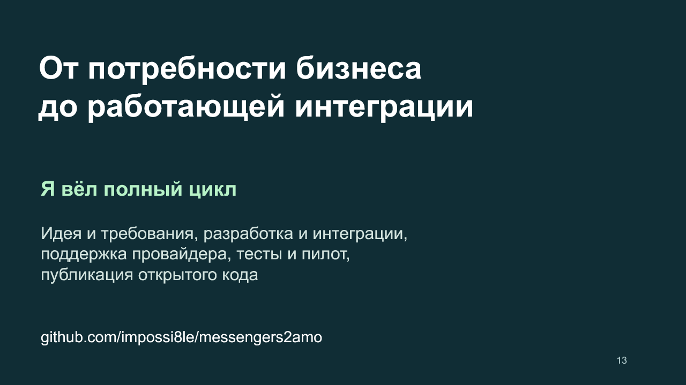

Реальные проверки выполнялись в ограниченном тестовом пилоте. Наличие исходников и адаптеров не означает полную готовность всех каналов. Открытые вопросы описаны в кейсе. Лицензия на внешнее использование исходников пока не установлена.
