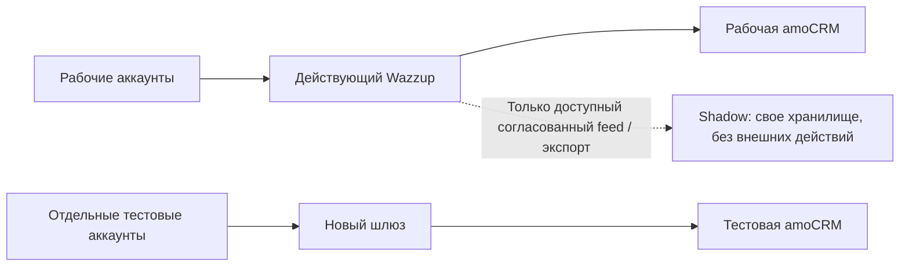

# Стек и план параллельного запуска на замену Wazzup

Дата: 21.10.2026; статус уточнён 22.10.2026. Назначение: практическое решение для запуска пилота, затем поэтапной замены Wazzup. Заказчик подтвердил amoCRM и назвал WhatsApp, Telegram, VK и MAX. Типы подключений, их текущая активность, права и нагрузка пока не обследованы. Это план реализации production-платформы. Локальный Telegram-стенд с отдельным тестовым ботом проверен: входящие, ответы, два аккаунта и 7 backend-тестов. На 22.10.2026 production-ядро реализовано и развёрнуто (`https://messengers.example.com`, `/health/live` и `/health/ready`); интеграция amoCRM (webhook по сырым байтам, OAuth, workflow) реализована, но live-проверка на рабочем аккаунте не выполнялась; боевые подключения каналов не проверены. См. [инструкцию стенда](../local-telegram/README.md).

## 1. Решение

Строим внутренний сервис одной компании. Сохраняем amoCRM основным рабочим местом менеджеров; пишем шлюз каналов, кабинет диагностики и минимальный виджет для назначения, спорных CRM-связей и подтверждения покрытия ответом. Полную CRM и весь интерфейс Wazzup не переписываем.

Параллельный старт означает отдельный стенд рядом с работающим Wazzup. Он не означает два независимых отправителя на одном рабочем номере. Базовый путь: **отдельные тестовые аккаунты → сравнение обработки → одно контролируемое переключение → остальные каналы**.

## 2. Какой стек принимаем для первой версии

Это рекомендуемый baseline проекта. Фактическая реализация на 22.10.2026: Fastify + `pg` + PostgreSQL (см. `apps/api/package.json`), React + Vite (см. `apps/web/package.json`); таблица ниже — исходный baseline, а не перечень установленных версий.

| Слой | Выбранная технология | Зачем |
|---|---|---|
| Runtime и язык | Node.js 24 LTS, TypeScript | Один язык для адаптеров, backend и UI; поддерживаемая LTS-ветка |
| Backend | NestJS, стандартный HTTP adapter Express | Модули подключений, webhook, прав, CRM и операторских команд |
| Данные | PostgreSQL 18 | Сообщения, связи CRM, обязательства ответа, журнал входящих и задания |
| Доступ к БД | `pg`, параметризованный SQL; миграции `node-pg-migrate` стабильной версии | Явные транзакции и блокировки критических операций без скрытой ORM-логики |
| Очередь пилота | Таблицы inbox/outbox/jobs PostgreSQL | Никакого обязательного Redis или RabbitMQ на первом этапе |
| Кабинет / виджет | React + TypeScript + Vite | Настройки, ошибки, назначение, ручное разрешение неоднозначностей; сборка виджета по правилам amoCRM |
| Вход сотрудников | Корпоративный OIDC при наличии; иначе закрытые администратором учетные записи с MFA и серверными сессиями в PostgreSQL | Публичная регистрация исключена; контекст пользователя виджета проверяется сервером, а не по переданному employee ID |
| Медиа | Приватное S3-совместимое объектное хранилище | Вложения, ограниченные ссылки; поставщик и регион выбираются по условиям компании |
| Развертывание | Linux VM, Docker Engine + Compose | Повторяемое развертывание API, workers и БД |
| HTTPS | Caddy 2 | Reverse proxy, TLS и обновление сертификатов |
| Логи / мониторинг | Pino JSON; Prometheus + Grafana либо существующий совместимый мониторинг | Очереди, ошибки, unknown, состояние каналов; внешняя проверка доступности |
| Backup | pgBackRest, WAL-архив и отдельное хранилище копий | Восстановление БД, проверяемое практическим restore |
| Проверки | Jest, Playwright, интеграционный стенд PostgreSQL и заглушки API | Проверка доменных правил, UI и аварийных сценариев |
| Репозиторий / сборка | Git, npm workspaces, npm lockfile, Docker images | Один репозиторий, зафиксированные зависимости и воспроизводимая сборка |

Node.js рекомендует поддерживаемые LTS-ветки для production; NestJS работает на Node.js/TypeScript, Vite имеет опубликованные требования к runtime. Конкретные совместимые версии NestJS, React, Vite, TypeScript и библиотек фиксируем lockfile после сборки стенда, без prerelease и плавающего `latest`. [Node.js](https://nodejs.org/en/about/previous-releases), [NestJS](https://docs.nestjs.com/first-steps), [Vite](https://vite.dev/guide/).

Критическая транзакция выполняется на одном соединении `pg`. Worker кратко захватывает задачу через блокировку/lease, завершает транзакцию и только затем обращается к внешнему API. Истекший lease не доказывает отсутствие отправки. `SKIP LOCKED` — механизм конкурентного выбора задач, а не гарантия exactly-once. [node-postgres](https://node-postgres.com/features/transactions), [PostgreSQL SELECT](https://www.postgresql.org/docs/18/sql-select.html), [миграции](https://salsita.github.io/node-pg-migrate/).

Caddy автоматизирует сертификаты при корректных DNS и условиях проверки домена. Для backup выбираем pgBackRest; наличие копии не заменяет проверку восстановления. [Caddy HTTPS](https://caddyserver.com/docs/automatic-https), [pgBackRest](https://pgbackrest.org/user-guide.html).

Отдельный брокер, Kubernetes, микросервисы и OpenTelemetry tracing не являются условиями первого теста. Брокер добавляем по измерениям очереди/нагрузки; сквозную трассировку — при необходимости. Логи, внешнее оповещение и диагностика обязательны уже в пилоте.

OAuth установленной CRM-интеграции не заменяет вход сотрудника. Связь пользователя кабинета с менеджером amoCRM проверяем отдельно. Кабинет и встроенный виджет имеют разные сборки/точки входа; загрузка виджета, CSP, контекст пользователя и ограничения cookies проверяются прототипом в реальной amoCRM. Обычная Vite SPA не считается автоматически готовым CRM-виджетом.

## 3. Что именно придется разработать

| Компонент | Минимальный результат |
|---|---|
| API приема | Проверка webhook отдельно по провайдеру, durable inbox, правильное подтверждение |
| Ядро сообщений | Стабильные идентификаторы, версии, дубли, состояния и поиск |
| Worker | Outbox, ограничение скорости, backoff, deadline, очередь ошибок, сверка unknown |
| Четыре адаптера | WA, Telegram, VK, MAX; фактические режимы существующих аккаунтов определят объем |
| amoCRM bridge | REST OAuth и отдельная интеграция Chats API; связи контактов/сделок/чатов |
| Минимальный UI | Подключения, отключение отправки, ошибки, assignment, спорный matching |
| Виджет | Контролируемые действия и снимок вопросов; при отсутствии надежных данных штатного чата — ручное покрытие |
| Эксплуатация | Роли, аудит, секреты, health, backup/restore, журнал переключений |

Успех HTTP API не означает прочтение клиентом. Неопределенная отправка не повторяется вслепую. Эти правила уже раскрыты в [доменной спецификации](messenger-domain-logic.ru.md) и [45 сценариях приемки](messenger-logic-acceptance.ru.md).

Фактическая структура на 22.10.2026: `apps/api` (API и worker как отдельные процессы), `apps/web` (React-консоль), `packages/{contracts,database,observability,amocrm-protocol}`, `ops/deploy/messengers2amo`. Исходное предложение (`apps/admin`, `apps/amo-widget`, `packages/domain`, `packages/adapters`) в таком виде не реализовано.

## 4. Первое действие — обследовать действующий Wazzup

Нужна карточка каждого подключения. Без нее нельзя обещать перенос существующего аккаунта.

| Что зафиксировать | Что сейчас известно |
|---|---|
| CRM-домен, account ID, администратор, тестовый аккаунт | amoCRM подтверждена; идентификаторы неизвестны |
| Wazzup account/channel IDs, фактический тип и состояние | Нужна инвентаризация |
| WhatsApp: связанное устройство, WABA или Coexistence | Неизвестно; наличие QR само по себе не определяет режим |
| WhatsApp: владелец номера, бизнес-портфолио/WABA, партнер, платежи, 2FA | Неизвестно |
| Telegram: Personal, Bot либо Secretary/Business; владелец | Неизвестно |
| VK: сообщество, владелец, Callback/Long Poll, текущие серверы | Назван пользователем; проверить фактическое подключение |
| MAX: бот/иной тип, владелец, подписки, доступ организации | Назван пользователем; режим и состояние неизвестны |
| CRM: текущие источники/воронки, роботы, боты, автоответы, задачи | Нужен список всех автоматизаций, зависящих от сообщений |
| Используемые функции | Группы, голосовые, исходящее первым, старые чаты, файлы, шаблоны, мобильная работа |
| Нагрузка | Число менеджеров/подключений, сообщения и медиа за день, пик, хранение |

Особенно важно записать функции, которые менеджеры реально используют: официальный бот может не заменить переписку личного аккаунта. Если критичные функции недоступны выбранному API, полноценная замена этого канала откладывается; демонстрация тестового бота не считается заменой Personal-режима.

## 5. Доступы и ресурсы, которые требуются

### От компании

- Ответственный администратор amoCRM и Wazzup; владелец каждого номера/бота/сообщества.
- Тестовый amoCRM-аккаунт. Если его нет — отдельная тестовая воронка в рабочем аккаунте только после согласования рисков: общие контакты, роботы и дедупликация все равно могут затрагивать рабочие данные.
- Создание собственной приватной интеграции amoCRM: REST OAuth и отдельный Chats channel через установленный порядок amoCRM. Собственный канал не наследует канал Wazzup. [amoCRM Chats](https://www.amocrm.ru/developers/content/chats/chat-start).
- Отдельный тестовый номер WhatsApp и возможность подтвердить его владельцем; свои бизнес-активы и оплата, если проверяем WABA.
- Отдельный Telegram-бот; при проверке Secretary/Personal — отдельный тестовый аккаунт и подтвержденная процедура подключения.
- Отдельные тестовое VK-сообщество и MAX-бот, с требуемыми правами и одобрением.
- Доступ к домену/DNS, серверу, объектному хранилищу и существующему мониторингу.
- Два пилотных менеджера, руководитель и технический ответственный; матрица прав и тестовые получатели.
- Решение о размещении, сроках хранения, доступе к переписке и копиях; защищенный способ передачи секретов.

В документ передаем только названия аккаунтов, ID, владельцев и состояние доступов. Токены, пароли, QR-сессии и ключи передаются через согласованное защищенное хранилище.

### Инфраструктура для первой попытки

Стартовый ориентир для небольшого теста: одна VM **4 vCPU, 8–16 GB RAM, 80–120 GB SSD**, отдельное приватное S3-хранилище медиа и отдельный backup bucket/репозиторий. Это начальная конфигурация, не подтвержденная нагрузочным тестом. Существующий сервер использовать можно, если обеспечены изоляция и лимиты ресурсов.

Нужны: DNS-имя тестового сервиса; публичный HTTPS webhook; административный интерфейс с ограничением доступа; приватная БД; исходящий доступ к провайдерам, CRM и хранилищам. Обычно используется 443; для выпуска сертификатов выбирается подходящий способ ACME, при необходимости 80 или DNS-проверка. БД не выставляется в интернет. Секреты монтируются только нужным процессам.

Одна VM — единая точка отказа, допустимая для теста. Перед переносом значимого рабочего трафика отдельно согласуем простой, резервирование и восстановление; разнос БД и приложения сам по себе не создает HA.

## 6. Как запустить параллельно и сохранить действующий сервис

| Режим | Какие действия разрешены |
|---|---|
| Изолированный тест | Отправка только тестовым получателям; запись только в тестовую CRM |
| Shadow | Прием разрешенной копии/экспорта, внутренняя обработка и сравнение; без отправок, CRM-записей, mark-read, автоответов |
| Рабочий пилот | Один специально выбранный физический аккаунт/канал полностью переводится на новый шлюз |
| Расширение | Остальные подключения переводятся по одному после приемки |

Shadow возможен только при поддержанном источнике данных. API Wazzup — кандидат, но доступ и схема должны быть подтверждены: User v3 и Partner v2 отличаются. Замена текущего webhook ради эксперимента может нарушить существующую интеграцию. Если безопасного feed нет, используем согласованный экспорт/обезличенные записи и отдельные тестовые аккаунты. [Wazzup Partner](https://wazzup24.ru/help/api/webhooks/), [User API](https://wazzup24.com/help/api-en/webhooks/).

Shadow через Wazzup проверяет нашу бизнес-обработку, но не независимость прямого транспорта. Для независимой замены отдельно проверяется каждый прямой адаптер.

Переключение нескольких тестовых клиентов на одном номере допустимо только при доказанном едином маршрутизаторе. Базовый план не требует такого разделения: переносим целиком один аккаунт с небольшой нагрузкой. Отдельная CRM-воронка не изолирует общий номер от второго отправителя.

## 7. Ограничения по каналам

| Канал | Первый безопасный тест | Перед переносом существующего |
|---|---|---|
| WhatsApp | Отдельный номер и выбранный подтвержденный API-режим | Определить QR/WABA/Coexistence; владение активами, совместимость функций, процедуру выхода от партнера и возврата |
| Telegram | Новый бот и тестовые клиенты | Определить Personal/Bot/Secretary; сохранить маршрут доставки и проверить смену подключения |
| VK | Тестовое сообщество | Инвентаризировать Callback/Long Poll и подписки; проверить отсутствие дублей и автоответов |
| MAX | Новый одобренный testbot | Установить тип рабочего подключения; сохранить подписки; проверить возможность переноса без конфликтов |

Telegram Bot API использует webhook либо getUpdates; второй потребитель токена не является безопасной копией потока. Для подключенного business bot Telegram документирует ограничение одного бота на пользовательский аккаунт. Не перехватываем рабочий webhook и не подключаем второго Secretary «просто для теста». [Bot API](https://core.telegram.org/bots/api#getting-updates), [connected business bots](https://core.telegram.org/api/bots/connected-business-bots).

WhatsApp Coexistence означает специальную совместимость Business App и бизнес-платформы, а не доказанную работу двух независимых CRM-интеграторов. QR встречается и в этом сценарии. Процедуру именно нашего номера подтверждаем отдельно; прямые страницы Meta о миграции при исследовании возвращали 429. [Wazzup: режимы](https://wazzup24.com/help/how-to-set-up/waba-and-whatsapp/), [Coexistence](https://wazzup24.ru/help/waba/coexistence-connection/).

В MAX наличие API списка подписок не доказывает возможность безопасного одновременного подключения двух сервисов. Для VK возможность Callback-серверов не устраняет двойные CRM-записи и автоответы. [MAX subscriptions](https://dev.max.ru/docs-api/methods/POST/subscriptions), [официальная схема VK](https://github.com/VKCOM/vk-api-schema/blob/master/groups/methods.json).

## 8. Защита теста от случайных рабочих действий

У окружения и подключения независимо задаются здоровье и разрешенные эффекты. В shadow все четыре разрешения выключены: `transport_send`, `crm_write`, `mark_read`, `automation_run`. Ошибка проверки или недоступная БД означает запрет действия.

Проверка эффекта включает окружение, разрешенный account/connection, получателя, CRM-аккаунт, activation ID, binding epoch и текущую политику. Для теста действуют allowlists. В shadow не выдаются рабочие отправляющие секреты; если API не разделяет права чтения/записи, применяется дополнительный ограниченный gateway или выбирается экспорт. Обычный сетевой allowlist домена не отличает чтение от отправки.

Один локальный флаг не отключает Wazzup: подтверждение остановки старого отправителя и CRM-проектора — отдельный пункт переключения. Lease/fencing нового worker не действует на старую систему и уже начавшиеся внешние вызовы.

## 9. План и критерии перехода

| Этап | Результат / условие |
|---|---|
| 0. Обследование | Заполнены четыре карточки, список функций/автоматизаций, владельцы и способ возврата |
| 1. Каркас | Репозиторий, сборка, HTTPS, БД, секреты, прием событий, журнал, восстановление копии |
| 2. Первая вертикаль | Тестовый канал → собственный Chats channel → ответ менеджера; без дублей |
| 3. Остальные тесты | Все четыре режима, которыми действительно пользуется компания; ограничения зафиксированы |
| 4. Shadow / сравнение | Если доступен feed: объяснены пропуски, дубли и различия; внешних действий нет |
| 5. Рабочий пилот | Один аккаунт, два менеджера, наблюдение и проверенный сценарий возврата |
| 6. Замена | По одному аккаунту; Wazzup отключается окончательно после проверки истории, медиа и договорных условий |

Для планирования: обследование — ориентир 1–2 рабочих дня при наличии администраторов. Первая сквозная вертикаль — ориентир 3–5 недель реализации после готовности доступов. Ограниченный пилот четырех каналов — ориентир 8–12 недель при 2 backend, частичной frontend/QA/DevOps занятости и параллельной работе. Это оценка, а не срок одобрения платформ. Полный набор функций Wazzup и личные режимы могут выйти за эти рамки; прежняя общая оценка 3–5 месяцев не считается гарантией.

Пилот допускается после проверок: нет дублирующих контактов/сообщений; неверные права отклоняются; медиа доступны и защищены; unknown не повторяется вслепую; отзыв токена/права виден; backup восстановлен; выключатель эффектов проверен; выбранные автоматизации не создают второй ответ. Наблюдение несколько смен — дополнительный этап, не замена испытаниям.

## 10. Переключение, история и откат

Перед переключением фиксируются текущие webhook/подписки, IDs Wazzup и нового канала, CRM bindings, активные автоматы, неотвеченные обращения и незавершенные отправки. Не следует одновременно выполнять два пути создания сущностей CRM.

Старые сообщения не загружаем в новый Chats channel как новые live-события. История остается отдельной задачей: новый канал не наследует идентификатор Wazzup. Доступность старых чатов и медиа после отключения/окончания подписки подтверждается до отказа от Wazzup. При экспорте отдельно проверяем сами файлы: старые URL могут быть недостаточны.

Порядок cutover: остановить старые исходящие и CRM-проекцию выбранного канала → сверить незавершенные действия → сохранить контрольную точку → выполнить подтвержденную внешнюю процедуру → проверить входящий и ответ → включить разрешения нового канала. Маршрут входящих и возможный промежуток недоставки/повторов фиксируются заранее. Общих IDs между Wazzup и прямым API может не быть: неоднозначные события переходного интервала разбираются, а не склеиваются только по тексту.

Откат начинается с запрета новых эффектов нового шлюза, сохранения результатов in-flight и сверки unknown. Затем восстанавливается проверенный старый маршрут; сверяются обращения за интервал. Обратная миграция WhatsApp/подключений не считается мгновенной или гарантированной. Если возврат рабочего аккаунта не подтвержден, его не выбираем первым для эксперимента. Ни удаление WABA/номера, ни отзыв приложения Wazzup не являются первым шагом.

## 11. Что нужно предоставить, чтобы начать

- [ ] Администраторы amoCRM/Wazzup и владельцы четырех каналов.
- [ ] Карточки фактических режимов подключения и список используемых функций.
- [ ] Тестовая amoCRM или явно согласованный ограниченный вариант.
- [ ] Тестовый номер WhatsApp, Telegram-бот, VK-сообщество, MAX-бот.
- [ ] Собственный приватный Chats channel и REST OAuth-интеграция.
- [ ] VM, DNS, приватное хранилище, offsite backup и безопасная передача секретов.
- [ ] Два пилотных менеджера, права, тестовые получатели и приемочные сценарии.
- [ ] Назначенные разработчики, QA и владелец эксплуатации.
- [ ] Подтвержденный план переключения/возврата первого рабочего подключения.

Ежемесячные затраты: VM + хранилище/трафик + backup + мониторинг + платежи каналам/партнерам + поддержка. Во время пилота сохраняется оплата Wazzup; экономия начинается после реального отказа от его каналов. Собственный сервер не отменяет платежи WhatsApp Business и работу по поддержке интеграций.

Итог первого этапа — доказанная тестовая вертикаль и понимание переносимости наших четырех аккаунтов. Только после этого можно решать, какую часть Wazzup заменяем первой.

Подробности: [архитектура](messenger-platform-architecture.ru.md), [требования](messenger-platform-requirements.ru.md), [логика](messenger-domain-logic.ru.md), [приемка](messenger-logic-acceptance.ru.md), проверка миграции (внутренние исследовательские материалы; в репозиторий не включены). Стек установлен и production развёрнут; реальные боевые учётные записи каналов и рабочего amoCRM, а также миграция существующего трафика не проверялись.
